<div align="center">

# ⌨️ musi-type

**Type the lyrics of any YouTube music video, in time with the song.**

Monkeytype-style typing on top of a real music video. If a video has no lyrics, no captions, or captions that are wrong, musi-type finds the real lyrics and works out *when* each line is sung.

*Inspired by [VocaType](https://video.vocatype.app/en/).*

### 🌸 [Try it live: musi-type-web.onrender.com](https://musi-type-web.onrender.com/)

<sub>It runs on a free host that sleeps when idle, so the first load can take up to a minute.</sub>


-f09ab0)

<br>

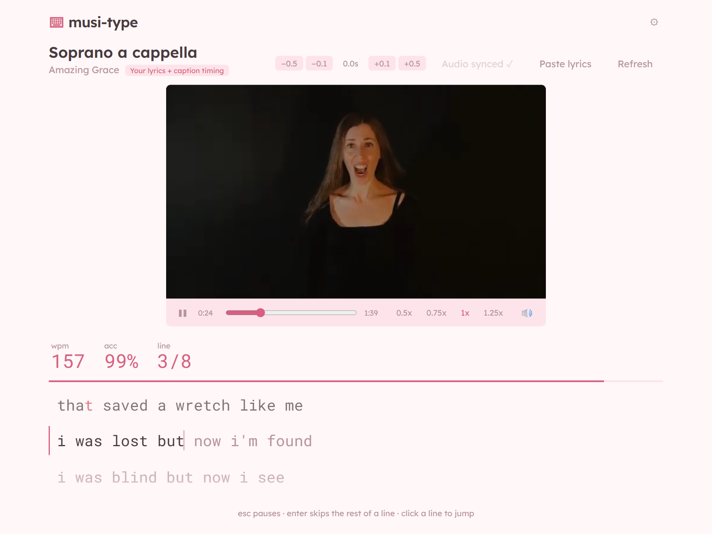

</div>

---

## Contents

- [Features](#features)
- [A tour](#a-tour)
- [Quick start](#quick-start)
- [How it works](#how-it-works)
- [FAQ](#faq)
- [Configuration](#configuration)
- [Project layout](#project-layout)
- [API](#api)
- [Troubleshooting](#troubleshooting)
- [Credits](#credits)
- [License](#license)

## Features

- **Paste any YouTube link**, or a bare video id, and start typing. The video plays in a custom player, so the keyboard never gets stuck inside the YouTube iframe.
- **Real lyrics, real timing.** Lyrics come from [LRCLIB](https://lrclib.net) (synced or plain), then Genius, then the video's own captions. Or paste your own.
- **Works when captions are bad or missing.** Plain lyrics are lined up against YouTube's captions, even the badly transcribed auto-generated ones. With no captions at all, an optional audio sync listens to the song with Whisper, on your CPU.
- **The video waits for you.** The default mode stops the video at the end of every line until you have typed it. Prefer pressure? *Follow video* locks a line when the song moves on. Or go *Free*.
- **Lyrics appear with the music.** Only the line being sung is typeable, with the next one faded as a preview, so you can't type the whole song ahead.
- **Keymap.** An on-screen keyboard under the lyrics, like Monkeytype's keymap mode. It outlines the key you need next, flashes green or red as you press keys, and points at Backspace when there's a mistake to fix. Switch it on or off in Settings.
- **Hard mode.** Turn it on in Settings and a line only counts when it is typed exactly right. A full line with a mistake stays open until you backspace and fix it, and Enter can't skip it.
- **Monkeytype-style scoring.** A live WPM that keeps ticking, accuracy, raw WPM, consistency and a per-second graph.
- **Four themes**: Sakura (default), Serika, Nord, Paper.
- **Fixable.** Nudge the timing with offset buttons, paste better lyrics, re-fetch, or re-sync from the audio.

## A tour

<table>
  <tr>
    <td width="50%"><b>Home</b><br>Paste a link. Recent songs are remembered in your browser.<br><br>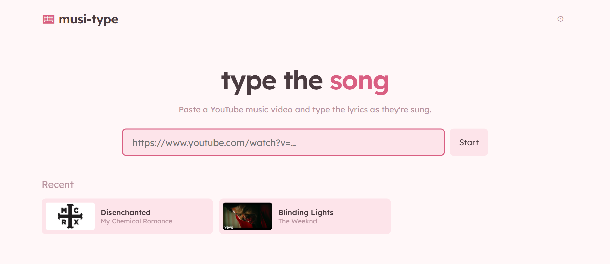</td>
    <td width="50%"><b>The video waits for you</b><br>Stop mid-line and the video holds until you finish it. The WPM keeps counting while you wait.<br><br>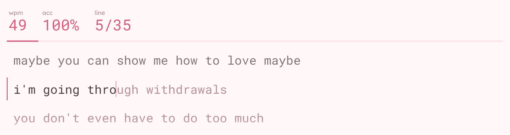</td>
  </tr>
  <tr>
    <td width="50%"><b>Paste your own lyrics</b><br>They are lined up with the video's captions (or the audio) automatically.<br><br>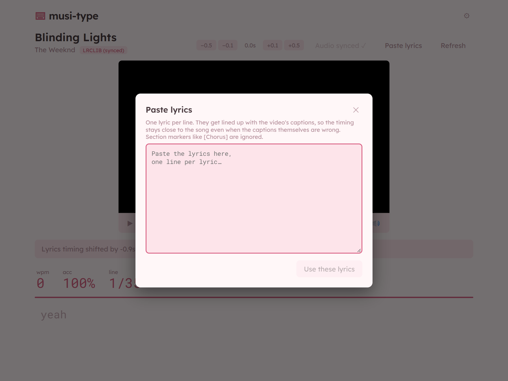</td>
    <td width="50%"><b>Settings</b><br>Typing mode, hard mode, keymap, what you have to type, lyric sources and themes.<br><br>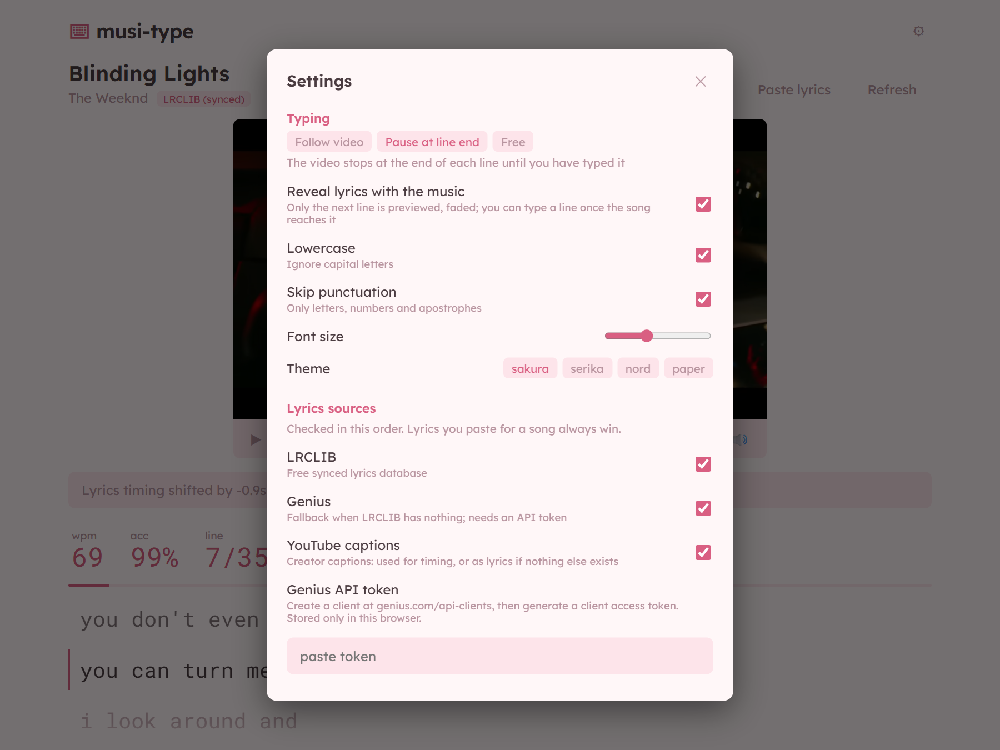</td>
  </tr>
</table>

**Keymap**: the on-screen keyboard lights up as you type, with the tips underneath.

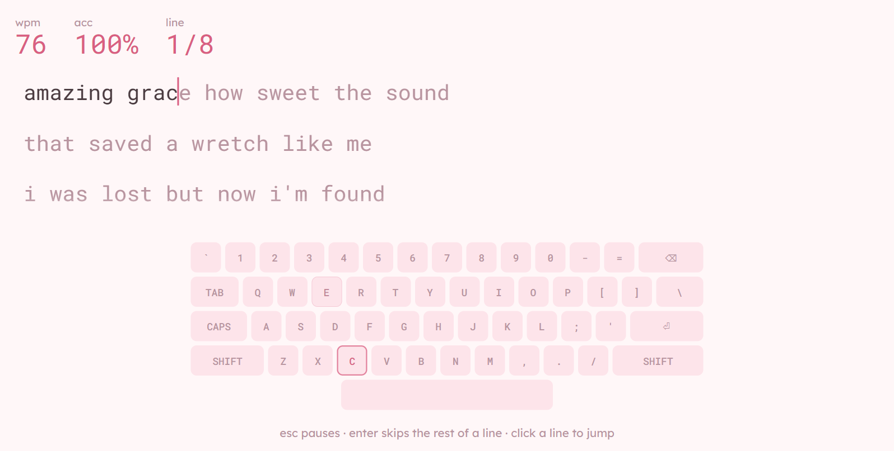

**Results**: WPM, accuracy, raw WPM, consistency, characters (correct / incorrect / missed) and a graph.

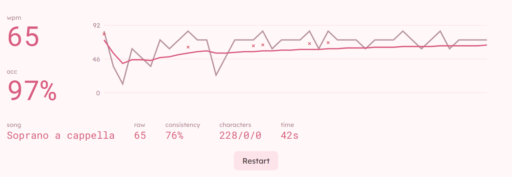

**Captions wrong or missing?** *Sync with audio* listens to the song and times the lyrics from the sound, on your own computer. Once it has run, the button reads "Audio synced ✓".

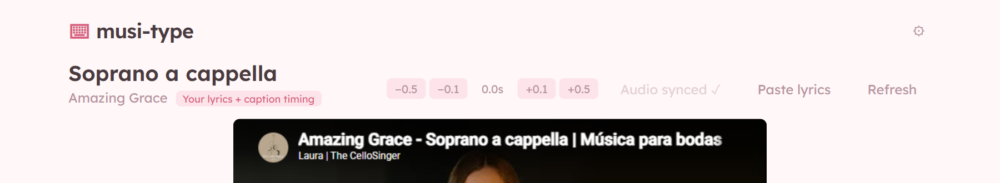

**Themes**

<table>
  <tr>
    <td align="center"><b>Sakura</b><br>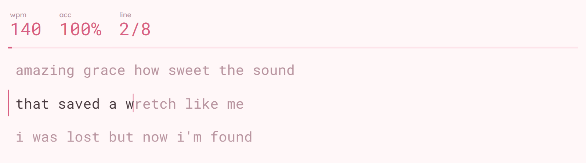</td>
    <td align="center"><b>Serika</b><br>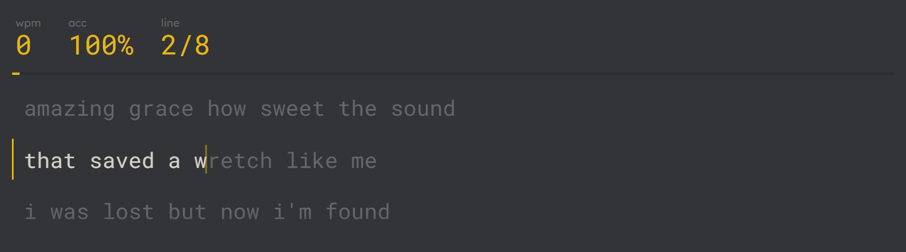</td>
  </tr>
  <tr>
    <td align="center"><b>Nord</b><br>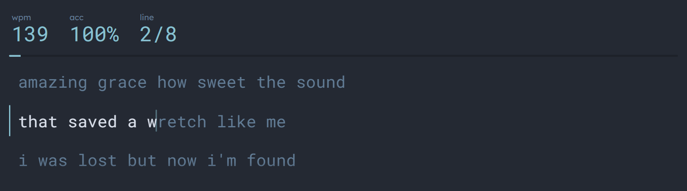</td>
    <td align="center"><b>Paper</b><br>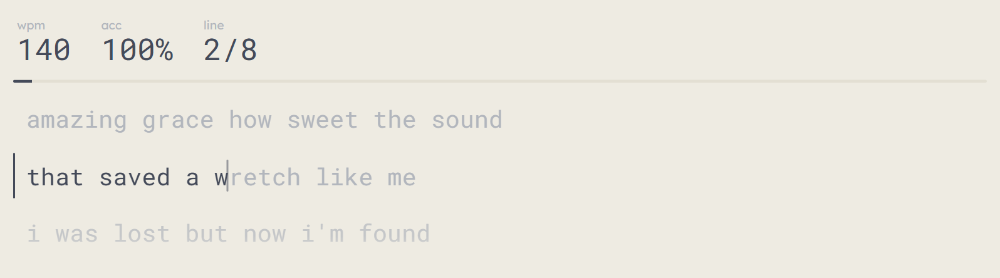</td>
  </tr>
</table>

## Quick start

### Prerequisites

| | Needed for | Install |
| --- | --- | --- |
| **Node.js 20+** (with npm) | the site and the API | [nodejs.org](https://nodejs.org), or `winget install OpenJS.NodeJS.LTS` / `brew install node` |
| **Python 3** (with pip) | running yt-dlp (3.9+; developed on 3.13) | [python.org](https://python.org), or `winget install Python.Python.3.12` / `brew install python` |
| **yt-dlp** | reading titles and captions from YouTube | installed for you by the launcher (`pip install -U yt-dlp`) |
| ffmpeg *(optional)* | audio sync | `winget install Gyan.FFmpeg` / `brew install ffmpeg` / `sudo apt install ffmpeg` |
| faster-whisper *(optional)* | audio sync | `node scripts/start.mjs --audio` (or `pip install faster-whisper`) |
| Internet | YouTube, LRCLIB, and Genius if enabled | |

You also need a **desktop browser** and a **physical keyboard**. About 1 GB of disk is enough, or roughly 1.5 GB with audio sync (Whisper model plus its libraries).

### One command

The launcher checks all of the above, installs what is missing (yt-dlp, the npm packages, and faster-whisper if you ask), starts the API and the site, and opens your browser:

```bash
git clone https://github.com/PrajasW/musi-type.git
cd musi-type

node scripts/start.mjs          # any OS
# or double-click / run:
run.bat                         # Windows
./run.sh                        # macOS / Linux  (bash run.sh if it isn't executable)
```

Options (pass them after the command, e.g. `run.bat --audio`):

| Option | Effect |
| --- | --- |
| `--audio` | also install faster-whisper, for the optional audio sync |
| `--check` | only report what is installed (also `npm run doctor`); changes nothing |
| `--no-open` | don't open the browser |

`npm start` does the same as `node scripts/start.mjs`. The site is at <http://localhost:5173> (API on `:8787`). Paste a YouTube link and press any key to start the song.

### Manual setup

If you would rather do it by hand:

```bash
pip install -U yt-dlp
npm install
npm run dev          # API on :8787, site on http://localhost:5173
```

Run the tests with `npm test` (36 tests: the aligner, caption parsers, typing logic and scoring).

## How it works

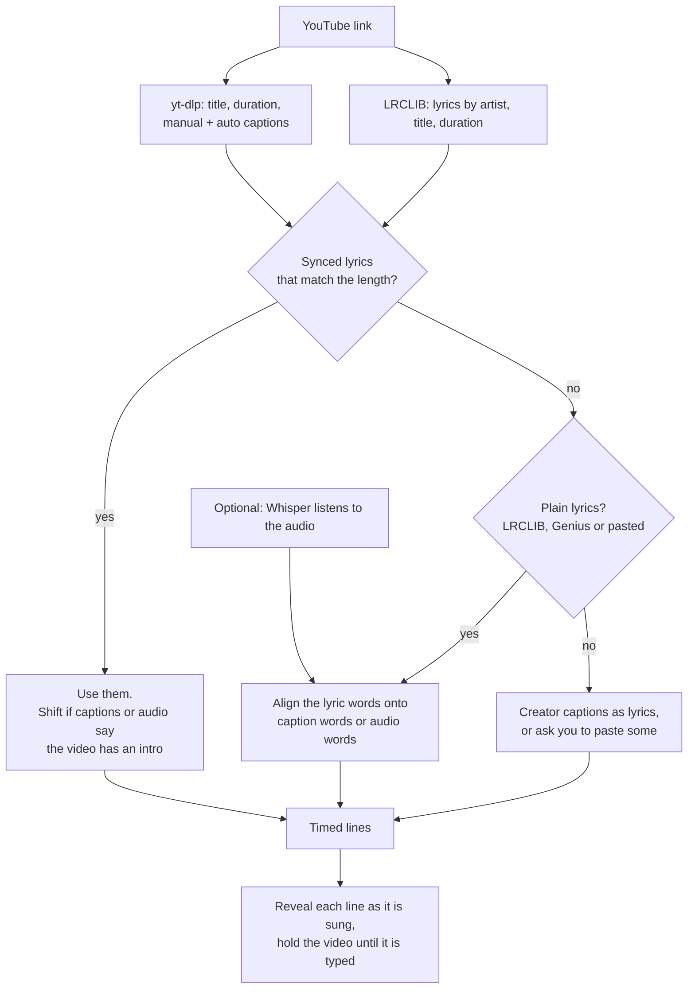

**Where each line's time comes from**, in order of preference:

| Situation | What happens |
| --- | --- |
| LRCLIB has synced lyrics for this length of video | Used as they are, then checked against captions or audio and shifted if the video clearly starts later or earlier. |
| Plain lyrics (LRCLIB, Genius, or pasted) and the video has captions | The lyric words are aligned onto the caption words, and take their times. |
| Plain lyrics and **no** captions | Press *Sync with audio*. Whisper gives word times from the sound, and the same aligner is used. |
| No lyrics found anywhere | The creator's captions are used if they exist. Otherwise you are asked to paste lyrics. |
| Nothing lines up | Lines are spread evenly over the song, with a warning and the offset buttons. |

## FAQ

<details>
<summary><b>Why does it need a server? Can't the browser read YouTube's captions?</b></summary>

No. Browsers can't fetch YouTube's caption files (cross-origin rules), and YouTube's official API only lets a video's *owner* download captions. So a small Express server runs [yt-dlp](https://github.com/yt-dlp/yt-dlp) to read titles, durations and captions, and calls LRCLIB and Genius. Everything is cached on disk in `server/cache/`, so a song is only fetched once.
</details>

<details>
<summary><b>Why not just use YouTube's auto-generated captions as the lyrics?</b></summary>

They are usually wrong, especially for music: misheard words, missing lines, no punctuation. But they are *good at one thing*: they know when words were sung. So musi-type uses them only for timing, and shows the real lyrics from LRCLIB, Genius, or what you pasted.
</details>

<details>
<summary><b>How are real lyrics lined up with wrong captions?</b></summary>

With a sequence alignment, in `server/src/align/align.ts`:

1. Both texts are normalised (lowercase, no accents or punctuation) and split into words.
2. A **Needleman–Wunsch** alignment matches the two word sequences in order. Two words match if they look alike (edit distance) or sound alike (a small phonetic key that ignores vowels, silent *gh*, `c/k`, `s/z`, and so on), so *tryna* matches *trina* and *lights* matches *lites*. Gaps are cheap, so extra or missing words on either side don't derail it.
3. Matching words become **anchors**: this lyric word is sung at that caption time. Anchors that go backwards in time are dropped.
4. Lyric words with no match get times interpolated between the nearest anchors, weighted by word length. Words in an instrumental gap stay glued to the line they belong to instead of being smeared across the break.
5. A line starts when its first word does.

Because it is a *global* alignment, repeated choruses are matched to the right occurrence, not all to the first. If fewer than about 25% of the words find a match, the result is flagged low-confidence, with a warning.
</details>

<details>
<summary><b>What if the video has no captions at all?</b></summary>

If LRCLIB has synced lyrics, they are used as they are. Otherwise there is nothing to time against, and you can press **Sync with audio** (see the next question). Without it, lines are spread evenly over the song, which is a rough guess (on *Blinding Lights* that was a 24 second median error), so the app warns you.
</details>

<details>
<summary><b>How does the audio sync work, and how good is it?</b></summary>

It is optional and runs entirely on your computer:

1. yt-dlp downloads the audio.
2. `server/scripts/transcribe.py` decodes it with ffmpeg and runs [faster-whisper](https://github.com/SYSTRAN/faster-whisper) on the CPU (`int8`, `base` model by default) to get **word-level timestamps**.
3. Those words feed the same aligner as caption words. So what you type is still the real lyrics; Whisper's misheard words only affect timing.
4. The result is cached, so a song is only processed once.

Details that mattered: Whisper's built-in voice filter treats singing over music as silence and returned zero words, so it is turned off. Lyrics, when known, are passed as Whisper's prompt so it favours the real words.

Measured on a laptop CPU against LRCLIB's synced timings:

| Song | Setup | Result |
| --- | --- | --- |
| *Blinding Lights* (captions removed) | even spread, no audio | 24.2 s median error, 0 of 35 lines within 1 s |
| *Blinding Lights* (captions removed) | audio sync, `base` | 0.28 s median, 28 of 35 within 1 s |
| *Disenchanted* (no captions, loud rock) | audio sync, `base` | 25 of 26 comparable lines within 1 s |
| *Disenchanted* | `small` model | slightly better (25 vs 24 of 26) and more words matched (74% vs 54%), but about three times slower |

A song takes about one to two minutes with `base`. Use `WHISPER_MODEL=small` for loud mixes if you can wait, or `tiny` to be fastest.
</details>

<details>
<summary><b>How does the video stop by itself when I'm not done typing?</b></summary>

In the default *Pause at line end* mode, the player's time is polled every 100 ms. When the video reaches 0.3 s before the next line starts and the current line isn't finished, the app pauses it. As soon as you complete the line, it resumes. If you pause the song yourself with Esc, it stays paused. The page says *Waiting for you…* while it holds.

The other modes: *Follow video* locks a line when the song moves on (typing ahead is fine), and *Free* never touches the video.
</details>

<details>
<summary><b>How do lines appear with the music?</b></summary>

A line becomes visible 0.2 s before it's sung, and nothing later can be typed. The next line is shown faded as a preview. If you finish a line early, your keys are ignored until the song reaches the next one. The first key you press starts the video, even before the first line has appeared. You can turn this off in Settings (*Reveal lyrics with the music*) to see everything.
</details>

<details>
<summary><b>How does the keymap work?</b></summary>

It is a US QWERTY keyboard drawn from `web/src/lib/keymap.ts`. For every character it knows the physical key and whether Shift is needed (capitals and symbols such as `!` or `?`).

- The key you need **next** is outlined. If the line has a mistake, the outline moves to **Backspace**.
- A key press flashes **green** when it was the expected character and **red** when it wasn't. Shifted characters light both Shift keys and the key.
- It only reads your key presses; it doesn't change scoring. Characters with no key on this layout (accents, symbols like ♪) simply aren't highlighted.

Turn it off in Settings (*Keymap*) if you want more room: the rest of the page, including the tips, stays where it was.
</details>

<details>
<summary><b>What happens when I type extra letters, or press space early?</b></summary>

Typing works on words, the way Monkeytype does it:

- A **space** moves to the next word, even if the current one is unfinished (the missing letters count as missed). A space at the start of a word does nothing.
- **Extra letters** typed past the end of a word are kept and shown after the word in red. Typing `thsaaa` for `the` shows the word with its wrong letter, then the extras. You can type up to 20 extras per word, and they count as incorrect characters.
- **Backspace** removes extras one at a time. It can go back into the previous word only if that word was wrong; a word you got right stays put.
- The **last word** of a line finishes the line as soon as it is exactly right, or when you press space (or Enter) on it.
- The keymap outlines **Backspace** while the current word has a mistake or extras.
</details>

<details>
<summary><b>What does hard mode do?</b></summary>

Normally you can move past a wrong word (mistakes cost accuracy, but you keep going). With **Hard mode** on, a line only counts when the whole sentence is exactly right:

- You can't leave a word until it is typed right: space does nothing while the word has a mistake or extras. The tip under the lyrics tells you to backspace and fix it.
- The last word has to be exactly right to finish the line, and Enter can't skip a line.
- Combined with *Pause at line end*, the video keeps waiting until the line is correct.

Toggling it restarts the current run, because the scoring rules changed.
</details>

<details>
<summary><b>How is WPM calculated?</b></summary>

The way [Monkeytype defines it](https://monkeytype.com/about):

- **WPM** = correct characters ÷ 5, per minute. **Raw** counts wrong characters too.
- **Accuracy** = correct keypresses ÷ all keypresses, so a fixed mistake still counts against you.
- **Consistency** comes from how much your per-second raw WPM varies: `100 × (1 − tanh(c + c³/3 + c⁵/5))`, where `c` is the standard deviation divided by the mean.
- The **clock starts at your first keystroke** and then keeps running, so the live WPM keeps updating (and falls while you are idle) instead of only changing when you type. It stops only when there is nothing to type (the next line hasn't appeared yet) or when you paused the song yourself. Time spent in *Waiting for you…* counts, because that is exactly when you are typing.
- The first second shows 0, so the number doesn't spike on the first few letters.
</details>

<details>
<summary><b>Why is the text lowercase with no punctuation?</b></summary>

So you only type what's on a normal keyboard: curly quotes, dashes and so on are normalised, capitals are lowercased and punctuation dropped (apostrophes stay). It's a setting: turn off *Lowercase* and *Skip punctuation* to type the lyrics exactly as written.
</details>

<details>
<summary><b>Why can't I click the video to pause it?</b></summary>

The YouTube iframe is covered by a click layer (and has `pointer-events: none`), so clicking never moves keyboard focus into the iframe, where your keystrokes would be lost. You get your own play/pause button, seek bar and speed control instead. Esc also pauses.
</details>

<details>
<summary><b>Where is my data stored? Is anything sent anywhere?</b></summary>

- **In your browser** (`localStorage`): settings, recently played songs, lyrics you pasted, and per-video timing offsets. Your Genius token is stored here too and sent only to your own local server, as a header.
- **On your machine** (`server/cache/`): fetched captions, lyrics and Whisper word timings.
- **To the internet**: YouTube (via yt-dlp and the embedded player), LRCLIB, and Genius if enabled. Whisper runs locally; the model is downloaded once from Hugging Face.
</details>

<details>
<summary><b>Some videos won't play. Why?</b></summary>

Uploaders can disable embedding. The page says so and links to the video on YouTube. You can still use the lyrics, but there's nothing to play.
</details>

<details>
<summary><b>The timing is off. How do I fix it?</b></summary>

In order of effort: the **−0.5 / −0.1 / +0.1 / +0.5** offset buttons (remembered per video), **Refresh** to re-fetch captions and lyrics, **Paste lyrics** to give it better lyrics, or **Sync with audio** to time them from the sound.
</details>

<details>
<summary><b>Does it work for songs that aren't in English?</b></summary>

The typing works with any text you can type, and LRCLIB has many languages. Timing is weaker: the phonetic matching is tuned for English, and auto-captions or Whisper are less reliable for other languages. Expect to use the offset buttons, or to paste lyrics and use audio sync.
</details>

<details>
<summary><b>Is this allowed? What about YouTube's terms?</b></summary>

It reads YouTube through yt-dlp and scrapes Genius pages, which sit in a grey area of their terms of service. It is built for **personal, local use**. The video is played with YouTube's own embedded player, and nothing is re-hosted.
</details>

<details>
<summary><b>How do I add another lyrics source?</b></summary>

Add a service next to `server/src/services/lrclib.ts` that returns plain or synced lyrics for an artist, title and duration, store its result on the `RawSong` object in `server/src/services/song.ts`, and add a step in `resolve()`. Anything that returns plain text gets aligned automatically.
</details>

## Configuration

| Variable | Default | What it does |
| --- | --- | --- |
| `PORT` | `8787` | API server port. The dev site proxies `/api` to it. |
| `YTDLP_BIN` | `yt-dlp`, else `python -m yt_dlp` | Path to yt-dlp if it isn't on `PATH`. |
| `PYTHON_BIN` | `python` / `python3` | Python used for audio sync. |
| `WHISPER_MODEL` | `base` | `tiny`, `base`, `small`, … Bigger is more accurate and slower. |

## Deploying

musi-type is a small Express API plus a static site. If you host it for other people, set these. Everything defaults to safe values when `NODE_ENV=production`.

| Variable | Default | What it does |
| --- | --- | --- |
| `NODE_ENV` | | Set to `production`. Turns audio sync off by default, trusts one proxy hop, and stops allowing localhost origins. |
| `ALLOWED_ORIGINS` | none | Comma-separated sites allowed to call the API from another origin (for example `https://musi-type.example`). Empty means same-origin only. |
| `TRUST_PROXY` | `1` in production | How many reverse-proxy hops to trust for the client IP. Rate limits are per IP, so this has to match your host (1 on Render and similar). |
| `RATE_API_PER_MIN` | `120` | Requests per minute per IP across the whole API. |
| `RATE_HEAVY_PER_MIN` | `20` | Song lookups and lyric alignments per minute per IP (they start yt-dlp and call other sites). |
| `RATE_AUDIO_PER_HOUR` | `3` | Audio sync starts per hour per IP. |
| `MAX_CONCURRENT_YTDLP` | `3` | yt-dlp processes at once. Extra requests wait up to 20 s, then get a 503. |
| `ENABLE_AUDIO_SYNC` | off in production | Whisper audio sync is CPU heavy. Turn it on only if the server can take it. |
| `MAX_AUDIO_SECONDS` | `900` | Longest video audio sync accepts. |
| `MAX_LYRICS_CHARS`, `MAX_LYRICS_WORDS` | `20000`, `3000` | Size limits on pasted lyrics. |
| `MAX_CACHE_FILES` | `3000` | The disk cache drops its oldest files past this. |
| `YOUTUBE_API_KEY` | none | Read titles and durations from the official YouTube Data API instead of yt-dlp. Useful when the host is bot-blocked. It has no caption information, so captions are still looked up through yt-dlp. |
| `YTDLP_COOKIES_FILE` | none | Path to a cookies file for yt-dlp. Datacenter IPs are often asked to prove they are not bots; cookies from a logged-in browser help. |

**On Render (a static site that rewrites `/api/*` to a separate web service)** the browser's requests reach the API through the static site's proxy, so two settings matter on the *API* service:

- `ALLOWED_ORIGINS=https://your-static-site.onrender.com`, **once you set `NODE_ENV=production`**. The API sees the proxy's host, not your site's, so in production the origin guard refuses POST requests (pasting lyrics, audio sync) from any origin not on the list. Outside production every origin is allowed. The server logs `[security] refused a request from origin …` once per origin when it refuses one.
- `TRUST_PROXY=2` (static-site proxy, then Render's router) if every visitor ends up sharing one rate-limit bucket. Check by loading `/api/health` from two networks and comparing the `RateLimit` header's `remaining` count: if the two counts drop together, raise `TRUST_PROXY` by one.

**Genius is per user.** There is no server-wide Genius key, and `GENIUS_TOKEN` is not read. Each person pastes their own token in Settings; it stays in their browser and travels only in the `x-genius-token` header of their own requests. The server uses it for that request, never writes it or the lyrics it fetched to the shared cache (they are kept in memory for an hour, per token), and never logs it. Responses are sent with `Cache-Control: no-store`.

**Abuse protection built in:** per-IP rate limits (general, costly endpoints, and audio sync separately), a shared cap across all clients on the costly endpoints (503 when exceeded), a cap on concurrent yt-dlp processes, strict video id and token validation, size limits on bodies and lyrics (100 KB, 20k characters, 3k words), a refusal of unknown browser origins and of HTTP methods the API never uses, security headers ([helmet](https://helmetjs.github.io)), short safe error messages (details only in the server log), only `genius.com` pages are ever fetched, a bounded disk cache, a cooldown on cache-busting refreshes, and server timeouts for slow clients. `npm test` covers all of it.

## Security

### How secrets are handled

- **Keys only on the server, only as environment variables.** `YOUTUBE_API_KEY` and `YTDLP_COOKIES_FILE` are read by the API service and used for outgoing requests. They are never sent to the browser, never in the repo, never in a URL, and never returned in a response.
- **Redaction.** Everything that goes to the logs or an error message passes through `server/src/redact.ts`, which blanks the value of any environment variable whose name contains KEY, TOKEN, SECRET, COOKIE, PASSWORD or AUTH, and anything shaped like a Bearer token, Google key, GitHub token or `?key=` parameter.
- **Genius tokens** are per user (see above) and live in that user's browser only.
- **A tripwire in the tests.** `server/src/secrets.test.ts` scans the whole repository for credential-shaped text, stray `.env` or cookie files, and secret names in the browser source. It runs in `npm test` and in CI, so a leaked key fails the build before it ships.

### What protects the site

- **Content Security Policy** in the production page: scripts only from the site and YouTube's player, connections only to the site's own origin, no plugins, no inline scripts, no framing by other origins through the headers below. A cross-site scripting bug therefore can't load attacker code or send data elsewhere.
- **Headers set by the host** (see below): no framing (clickjacking), no MIME sniffing, a strict referrer policy, HSTS, and a locked-down permissions policy.
- **React escapes everything it renders**, and the code never uses `innerHTML`, `eval` or similar. Lyrics, titles and pasted text are always plain text.
- **Dependencies:** `npm audit` is clean, Dependabot opens update PRs weekly, and CI fails on known high-severity vulnerabilities in production dependencies.

### Headers on Render's static site

Render sets these in the dashboard, not in the repo: open the static site, then **Headers**, and add them for the path `/*`:

| Header | Value |
| --- | --- |
| `X-Frame-Options` | `DENY` |
| `Content-Security-Policy` | `frame-ancestors 'none'` |
| `X-Content-Type-Options` | `nosniff` |
| `Referrer-Policy` | `strict-origin-when-cross-origin` |
| `Permissions-Policy` | `camera=(), microphone=(), geolocation=(), payment=(), usb=(), interest-cohort=()` |
| `Strict-Transport-Security` | `max-age=31536000; includeSubDomains` |

(The rest of the Content Security Policy is already built into the page itself; `frame-ancestors` can only be set as a header.)

### Checklist for the person running it

These can't be done from code:

1. **Restrict the YouTube Data API key** in Google Cloud Console: under *APIs & Services → Credentials*, limit it to the *YouTube Data API v3* only, and set a daily quota so a leak can't run up a bill.
2. **Rotate any key that has ever been pasted into a chat, an issue, or a screenshot.** Treat it as public.
3. **Turn on GitHub secret scanning and push protection** (repository *Settings → Code security*). They are free for public repositories and block a push that contains a key.
4. **Keep keys in Render's environment settings**, never in `render.yaml`, the build command, or a committed file.
5. **Turn on auto-deploy** for the services, so a security fix reaches the site as soon as it is merged.
6. Optionally put the site behind Cloudflare's free plan for bot filtering and a WAF, on top of the limits here.

Found a vulnerability? See [SECURITY.md](SECURITY.md).

## Project layout

```
musi-type/
├── server/                 Express API (TypeScript, run with tsx)
│   ├── scripts/transcribe.py   faster-whisper word timestamps
│   └── src/
│       ├── align/          normalise.ts, align.ts (+ tests): lyrics ↔ caption words
│       ├── services/       ytdlp, captions (json3 + vtt), lrclib, genius,
│       │                   audio (Whisper jobs), song (resolution order)
│       ├── routes/song.ts  HTTP endpoints
│       └── cache.ts        JSON files in server/cache/
├── web/                    React + Vite site
│   └── src/
│       ├── lib/            typing.ts (reducer, scoring + tests), api, settings
│       ├── hooks/          useTyping (clock + stats), useYouTubePlayer, useAudioSync
│       ├── components/     TypingArea, PlayerPanel, Results, SettingsModal, …
│       └── pages/          Home, Watch
└── docs/images/            screenshots used in this README
```

## API

| Endpoint | Purpose |
| --- | --- |
| `GET /api/song?v=<id>` | Timed lyrics for a video. Optional `lrclib`, `genius`, `ytManual` flags (`0`/`1`), `refresh=1`. |
| `POST /api/align` | `{ videoId, lyrics }`: line up pasted lyrics with the video. |
| `GET /api/audio-sync?v=<id>` | Is audio sync available, and the state and progress of a job. |
| `POST /api/audio-sync` | `{ videoId, lyrics? }`: start audio sync (one job at a time). |
| `GET /api/health` | Liveness check. |

## Troubleshooting

- **Captions or titles stop loading.** YouTube changed something: `pip install -U yt-dlp`.
- **"Sync with audio" is greyed out.** `pip install faster-whisper`, and make sure `ffmpeg` is on your PATH. Restart the server afterwards.
- **Audio sync finds no words.** Try `WHISPER_MODEL=small`. Very quiet vocals under heavy instruments are hard.
- **Lyrics found, but they feel early or late.** Use the offset buttons; check that the video isn't an extended or live version of the studio track.
- **Port already in use.** Set `PORT`, and change the proxy target in `web/vite.config.ts`.

## Credits

- Inspired by [VocaType](https://video.vocatype.app/en/), which types along to YouTube videos.
- Typing feel and scoring: [Monkeytype](https://monkeytype.com).
- Lyrics: [LRCLIB](https://lrclib.net) and [Genius](https://genius.com).
- Captions and audio: [yt-dlp](https://github.com/yt-dlp/yt-dlp). Speech recognition: [faster-whisper](https://github.com/SYSTRAN/faster-whisper).
- The screenshots use "Amazing Grace - Soprano a cappella" by Laura | The CelloSinger ([YouTube](https://www.youtube.com/watch?v=vlDhQG9cMEg), licensed [CC BY](https://creativecommons.org/licenses/by/3.0/)). The hymn's words are in the public domain.

## License

Copyright (C) 2026 Prajas Wadekar

musi-type is free software under the [GNU Affero General Public License v3.0](LICENSE). You may use, study, change and share it. If you run a modified version as a website for other people, the AGPL requires you to offer them the source code of your version under the same license.
